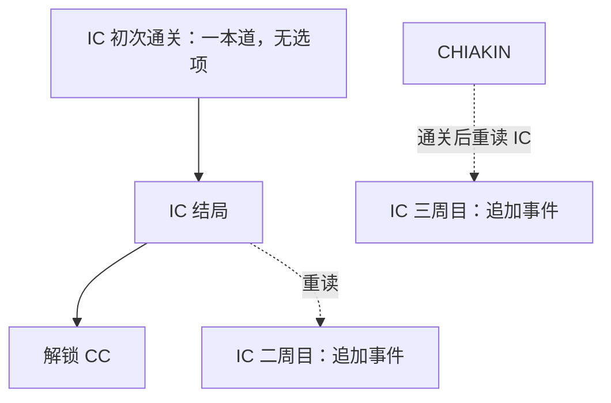
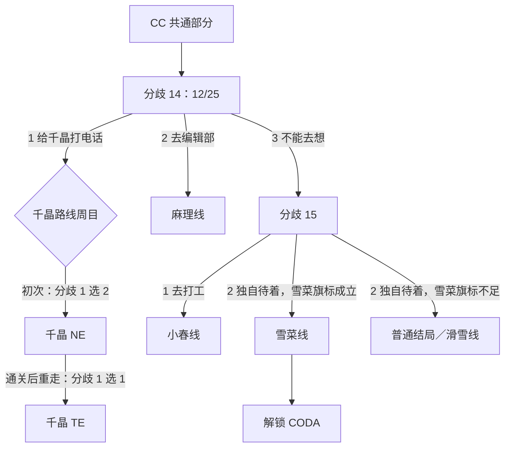
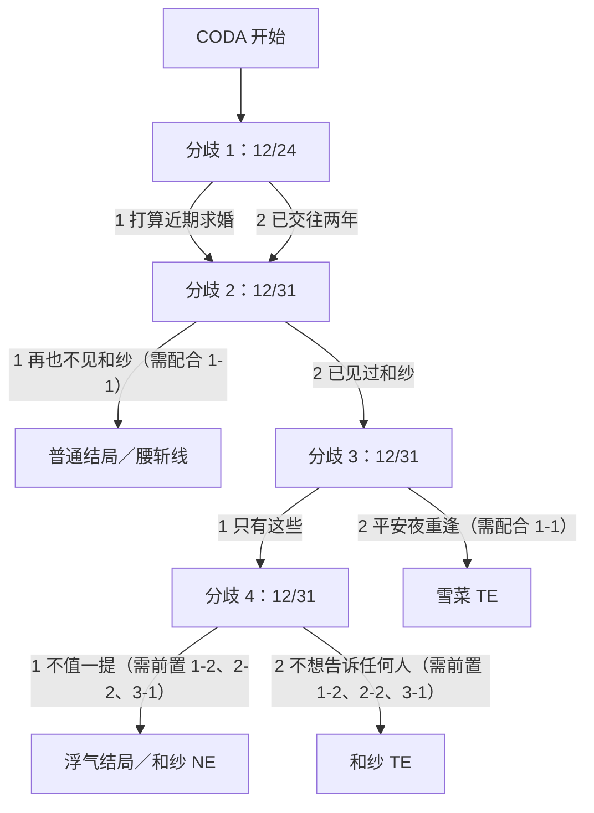

> 适用：PS Vita《WHITE ALBUM2 幸せの向こう側》（PSV-2000 主机）。含本篇 IC、CC、CODA 的全部分歧与结局；不复述剧情正文。选项编号按本攻略的分歧编号，不是游戏画面上的数字提示。以选项文字为准。

## 章节与结局

本篇依次为 `introductory chapter (IC)`、`closing chapter (CC)`、`CODA`。IC 是一本道，没有选择；通关 IC 后开放 CC；完成 CC 雪菜线后开放 CODA。PS Vita 版与 PC、PS3 版的主线选项相同，PS3/Vita 版的 CODA「浮气结局」后会追加《不共戴天的君へ》。

本篇共 11 个结局：IC 1 个、CC 6 个、CODA 4 个。千晶 TE 需先完成千晶 NE，CODA 需先完成 CC 雪菜线。画面中灰色选项暂不可选；有些选项会因前置分歧而不出现，这是正常流程。

## 章节路线图

### IC

### CC

### CODA

## 推荐通关顺序

1. IC 一周目通关。想补齐 IC 的追加事件，可在 IC 二周目再读一遍。
2. CC 普通结局（滑雪线）。
3. CC 小春线、麻理线（顺序不限）。
4. CC 千晶 NE。
5. 回到 IC 三周目，观看千晶 NE 后追加的事件。
6. CC 千晶 TE。
7. CC 雪菜线；这是进入 CODA 的前置，建议放在 CC 最后。
8. CODA 普通结局、浮气结局、和纱 TE、雪菜 TE。浮气结局后先看追加篇，再继续其他结局。

每次进入 CC/CODA 前及每个目标结局前都建议另存档。周回时可用「只跳过已读」；读到新增事件或未读选项时会自动停下。

## CC 选项对照

格式 `分歧-选项`，例如 `1-2` 表示选择 CC 分歧 1 的第 2 项。日期可能因前一个选项变为隔日。

| 分歧 | 日期 | 选项 1 | 选项 2 | 选项 3 |
|---|---|---|---|---|
| 1 | 12/1 | 「这家伙真难对付」※千晶 NE 后解锁，开千晶 TE 旗标 | 「和她在一起觉得很舒服」 | — |
| 2 | 12/2 | 给雪菜打电话 | 给雪菜发短信 | — |
| 3 | 12/3 | 拒绝 | 接受麻理的邀请 | — |
| 4 | 12/5 | 送小春回去 | 目送小春回去 | — |
| 5 | 12/8 | 让千晶睡在床上 | 叫千晶起来 | — |
| 6 | 12/12 | 送小春回去 | 目送小春回去 | — |
| 7 | 12/14 | 这不是那么简单的事 | 都是过去的事了 | — |
| 8 | 12/17 | 好，就今天吧 | 抱歉，明天再说 | — |
| 9 | 12/17 或 12/18 | 再聊一会儿 | 今天先回去吧 | — |
| 10 | 12/18 或 12/19 | 随便你吧 | 可以才怪 | — |
| 11 | 12/20 | 你果然还是来这里吧 | 我现在就去你那边 | — |
| 12 | 12/21 | 那就只要一本吧 | 不需要 | — |
| 13 | 12/22 | 嘛，无所谓了 | 难道那家伙…… | — |
| 14 | 12/25 | 给千晶打电话 | 去编辑部露面 | 那种事怎么能去想 |
| 15 | 12/25 后 | 去打工 | 一直独自待着 | — |

分歧 8-2 需要麻理好感达到条件；分歧 12-2 只有接着 8-2 才会出现。分歧 11-2 在千晶旗标关闭后不可选；分歧 13-2 在小春旗标关闭后不可选。分歧 14 选 3 才会继续到分歧 15。大晦日出现的「去音乐会」是锁定的假选项，不可选。

### CC 各结局路线

照目标一行从左到右选择；未列出的分歧表示该路线不会出现该项。

| 结局 | 选择顺序 |
|---|---|
| 普通结局／滑雪线 | `1-2 → 2-2 → 3-1 → 4-2 → 5-2 → 6-2 → 7-1 → 8-1 → 9-1 → 10-2 → 11-1 → 12-1 → 13-1 → 14-3 → 15-2` |
| 小春线 | `1-2 → 2-2 → 3-1 → 4-1 → 5-2 → 6-1 → 7-1 → 8-1 → 9-2 → 10-1 → 11-1 → 12-1 → 13-2 → 14-3 → 15-1` |
| 麻理线 | `1-2 → 2-2 → 3-2 → 4-2 → 5-2 → 6-2 → 7-2 → 8-2 → 9-2 → 10-2 → 11-1 → 12-2 → 13-1 → 14-2` |
| 千晶 NE | `1-2 → 2-2 → 3-1 → 4-2 → 5-1 → 6-2 → 7-1 → 8-1 → 9-1 → 10-2 → 11-2 → 12-1 → 13-1 → 14-1` |
| 千晶 TE | 先完成千晶 NE；重走上方千晶路线，将第一项改为 `1-1`，其余不变。 |
| 雪菜线 | `1-2 → 2-1 → 3-2 → 4-2 → 5-2 → 6-2 → 7-1 → 8-1 → 9-2 → 10-1 → 11-1 → 12-1 → 13-1 → 14-3 → 15-2` |

## CODA 选项对照

同样用 `分歧-选项` 标记。CODA 分歧依赖前面的选择，没出现的项直接跳过，不需要回头补选。

| 分歧 | 日期 | 选项 1 | 选项 2 |
|---|---|---|---|
| 1 | 12/24 | 打算近期向雪菜求婚 | 已经交往两年了 |
| 2 | 12/31 | 再也不去见和纱 | 已经见过和纱了 |
| 3 | 12/31，选 2-2 后 | 只有这些 | 与和纱重逢是在平安夜 |
| 4 | 12/31，选 3-1 后 | 不值一提的事 | 不想告诉任何人 |
| 5 | 1/13 | 想听雪菜的声音 | 约定过不主动打电话给她 |
| 6 | 1/13，选 5-2 后 | 因为这是为了和纱 | 因为没什么好担心的 |
| 7 | 1/18 | 我不会去 | 我不能去 |
| 8 | 1/19 | 抱住她 | 让她靠在胸前 |
| 9 | 1/21 | 回去 | 看着和纱的睡脸 |
| 10 | 1/21，选 9-2 后 | 想一直留在这里 | 想抱紧她 |
| 11 | 1/25 | 看向别处 | 看着和纱的眼睛 |
| 12 | 1/27 | 我只是想见雪菜 | 老实说出和纱的事 |
| 13 | 1/29 | 放开手 | 把脸转开 |
| 14 | 1/29，选 13-2 后 | 我爱着雪菜 | 我无法对和纱说谎 |

关键跳转：`2-1` 会开启 CODA 普通线旗标，并跳过分歧 3、4、11、12；`5-1` 跳过分歧 6；`9-1` 跳过分歧 10；`13-1` 直接进入浮气结局，不会出现分歧 14。选 `14-2` 需要和纱好感达到最高；雪菜 TE 则要在 `12-2` 开启雪菜旗标。

### CODA 各结局路线

#### 普通结局（腰斩线）

`1-1 → 2-1 → 5-1 → 7-1 → 8-2 → 9-1 → 13-2 → 14-1`

`2-1` 后分歧 3、4、11、12 自动跳过；`5-1` 后跳过 6；`9-1` 后跳过 10。若选项 13、14 未按上表出现，先检查是否误进其他旗标路线。

#### 浮气结局（和纱 NE）

`1-2 → 2-2 → 3-1 → 4-1 → 5-2 → 6-1 → 7-2 → 8-1 → 9-2 → 10-2 → 11-2 → 12-1 → 13-1`

完成后可在 PS Vita 的 SPECIAL 中观看追加篇《不共戴天的君へ》。浮气线 2/14 还有一处分歧，选项为「摘下眼镜」或「就这样吻上去」，对应不同 CG；想补齐差分就在该处存档并各选一次。

#### 和纱 TE

`1-2 → 2-2 → 3-1 → 4-2 → 5-2 → 6-1 → 7-2 → 8-1 → 9-2 → 10-1 → 11-2 → 12-1 → 13-2 → 14-2`

这是容错最低的线；若分歧 14-2 不出现，说明和纱好感不足。按本路线从头重选，不要只从最后一处分歧读档。

#### 雪菜 TE

`1-1 → 2-2 → 3-2 → 5-1 → 7-1 → 8-2 → 9-1 → 11-1 → 12-2 → 13-2 → 14-1`

选 `5-1` 后不会出现分歧 6；`9-1` 后不会出现分歧 10。`12-2` 是开启雪菜旗标的关键。结尾选 `14-1` 后，最终旗标判定仍会依雪菜旗标确认进入雪菜 TE。

## PS Vita 白金奖杯

PS Vita 奖杯表共 **31 项：白金 1、金 5、银 11、铜 14**。奖杯显示名保留日文，方便对照主机奖杯列表；条件用中文概述。

| 等级 | 奖杯名称（日文） | 获取条件 |
|---|---|---|
| 白金 | `ホワイトアルバム2マイスター` | 获得本作全部奖杯。 |
| 金 | `本編コンプリート` | 获得 IC、CC、CODA 三章的完成奖杯。 |
| 金 | `codaかずさエンド` | 完成 CODA 和纱 TE。 |
| 金 | `coda雪菜エンド` | 完成 CODA 雪菜 TE。 |
| 金 | `coda浮気エンド` | 完成 CODA 浮气结局（和纱 NE）。 |
| 金 | `不倶戴天の君へ` | 完成浮气结局后解锁的追加篇《不共戴天的君へ》。 |
| 银 | `introductory chapterコンプリート` | 看完 IC 全部事件，包括二周目追加段落及 CC 千晶 NE 后的 IC 千晶篇。 |
| 银 | `closing chapterコンプリート` | 看完 CC 全部结局。 |
| 银 | `codaコンプリート` | 看完 CODA 普通、雪菜、和纱、浮气四个结局。 |
| 银 | `小木曽雪菜エンド` | 完成 CC 雪菜线。 |
| 银 | `杉浦小春エンド` | 完成 CC 小春线。 |
| 银 | `和泉千晶エンド` | 完成 CC 千晶 TE。 |
| 银 | `風岡麻理エンド` | 完成 CC 麻理线。 |
| 银 | `ビジュアルCGコンプリート` | 收齐全部 CG；注意浮气线 2/14 两种选择差分及追加篇 CG。 |
| 银 | `ミュージックコンプリート` | 听过全部 BGM；通常看完各结局即可收齐。 |
| 银 | `デジタルノベルコンプリート` | 阅读 SPECIAL 内全部数字小说。 |
| 银 | `ボイスドラマコンプリート` | 听完 SPECIAL 内全部语音剧。 |
| 铜 | `introductory chapterクリア` | 完成 IC 一周目。 |
| 铜 | `introductory chapter2周目クリア` | 完成 IC 二周目及新增事件。 |
| 铜 | `introductory chapter千晶エピソード` | CC 千晶 NE 后重读 IC，观看追加的千晶篇。 |
| 铜 | `和泉千晶ノーマルエンド` | 完成 CC 千晶 NE。 |
| 铜 | `closing chapterノーマルエンド` | 完成 CC 普通结局／滑雪线。 |
| 铜 | `codaノーマルエンド` | 完成 CODA 普通结局／腰斩线。 |
| 铜 | `雪が解け、そして雪が降るまで` | 阅读同名数字小说。 |
| 铜 | `彼の神様、あいつの救世主` | 阅读同名数字小说。 |
| 铜 | `祭りの前 ～ふたりの二十四時間～` | 听完同名语音剧。 |
| 铜 | `祭りの後 ～雪菜の三十分～` | 阅读同名数字小说；先听语音剧《祭りの前》解锁。 |
| 铜 | `Twinkle Snow ～夢想～` | 阅读同名数字小说。 |
| 铜 | `歌を忘れた偶像(アイドル)` | 阅读同名数字小说。 |
| 铜 | `祭りの日 ～舞台の下の物語～` | 听完同名语音剧。 |
| 铜 | `一泊二日の凱旋` | 听完同名语音剧。 |

### 白金收尾顺序

1. 按上面的流程拿齐 IC、CC 和 CODA 结局；CC 千晶 NE 后回 IC 看千晶篇，IC 二周目事件也要看完。
2. 完成 CODA 浮气结局并通关追加篇《不共戴天的君へ》；浮气线 2/14 两种选择都要回收，补齐 CG 差分。
3. 在标题画面的 SPECIAL 里读完全部 5 篇数字小说、听完全部 3 篇语音剧。`祭りの後 ～雪菜の三十分～` 要先听 `祭りの前 ～ふたりの二十四時間～` 才会解锁。
4. 确认各章完成奖杯、CG、音乐、数字小说和语音剧完成奖杯均已弹出；最后获得白金 `ホワイトアルバム2マイスター`。白金后还会追加角色语音留言。

## 全结局核对

- [ ] IC 结局
- [ ] CC 普通结局／滑雪线
- [ ] CC 小春线
- [ ] CC 麻理线
- [ ] CC 千晶 NE
- [ ] CC 千晶 TE
- [ ] CC 雪菜线
- [ ] CODA 普通结局／腰斩线
- [ ] CODA 浮气结局／和纱 NE
- [ ] CODA 和纱 TE
- [ ] CODA 雪菜 TE
- [ ] IC 二周目追加事件
- [ ] IC 三周目追加事件（CC 千晶 NE 后）
- [ ] CODA 浮气线 2/14 两种 CG 差分
- [ ] 《不共戴天的君へ》追加篇
- [ ] PSV 全 31 项奖杯／白金

## 资料来源

- [Aquaplus 官方：PS Vita 版系统说明](https://aquaplus.jp/wa2vita/system/)（灰色选项不可选）
- [GameLine：PS3／PS Vita 奖杯列表与条件](https://gameline.jp/white-album2/trophy-list-ps3-vita/)
- [Game-Kouryaku：奖杯列表与白金路线](https://game-kouryaku.info/whitealbum2/trophy.html)
- [GameLine：数字小说、语音剧与解锁条件](https://gameline.jp/white-album2/digitalnovel-voicedrama-list/)
- [日文攻略：WHITE ALBUM 2 攻略总页](https://adusa-ciel.my.coocan.jp/WA2/white_album2.htm)（PC、PS3、PS Vita 主线选项一致；章节开放条件）
- [3DM：CC/CODA 全线选择攻略](https://www.3dmgame.com/gl/3710683.html)（CC 全选项与路线序列）
- [3DM：CODA 全线选择](https://www.3dmgame.com/gl/3710683_7.html)
- [3DM：CODA 雪菜 TE](https://www.3dmgame.com/gl/3710683_8.html) · [和纱 TE 与浮气结局](https://www.3dmgame.com/gl/3710683_9.html) · [普通结局](https://www.3dmgame.com/gl/3710683_10.html)
- [GameLine：推荐通关顺序](https://gameline.jp/white-album2/recommended-order/) · [全结局与追加内容 FAQ](https://gameline.jp/white-album2/faq/)
